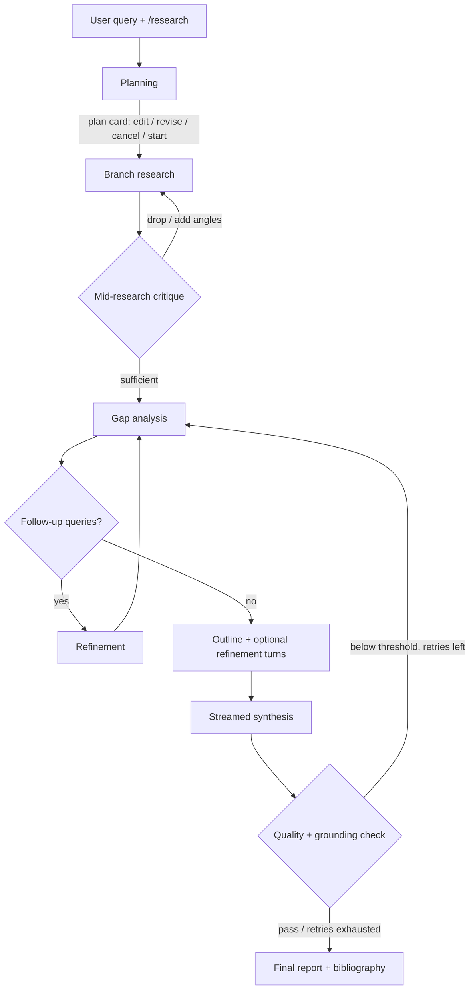

# Deep Research Pipeline

Deep Research is Katab's most involved feature. It is a **meta-mode**: instead of a single
tool-calling turn, it runs a structured pipeline — planning → branch research → critique → gap
analysis → refinement → two-pass synthesis → quality check.

**Activation**

- `/research` in the prompt, or
- the **Research** row in the footer **Tools** popup set to **On** (binary Off/On toggle), or
- autonomously, when the model selects the `deep_research` meta-tool.

Deep Research requires at least one research tool to be usable: Web Search or Web Scraper.

## Contents

- [Module Map](#module-map)
- [Pipeline](#pipeline)
- [State and Progress UI](#state-and-progress-ui)
- [Depth and Model Overrides](#depth-and-model-overrides)
- [Compression Pipeline](#compression-pipeline)
- [Thresholds and Constants](#thresholds-and-constants)
- [Tool-result truncation tiers](#tool-result-truncation-tiers)
- [How It Differs from Regular Tool-Calling](#how-it-differs-from-regular-tool-calling)
- [Performance and Failure Handling](#performance-and-failure-handling)

---

## Module Map

| Concern | Location |
|---|---|
| Phase orchestration, progress timeline, plan approval UI | `extension.js` (`_sendMessage`, `_runSynthesisPhase`, `_runResearchBranches`, `_runRefinementResearch`, `_runQualityCheck`) |
| Planner + plan revision | `src/research/planner.js` |
| Gap analysis, critique, causal-chain check, outline, quality check | `src/research/pipeline.js` |
| Branch execution, subpage following, refinement, retries | `src/research/branchRunner.js` |
| Compression (per page, merge) | `src/research/compressionTools.js` |
| Final prompt + contradiction/grounding checks | `src/research/synthesisPrompt.js` |
| Citation → bibliography binding | `src/research/citationTracker.js` |
| Cache + crash-recovery checkpoints | `src/research/researchCache.js` |
| Prompts and response parsers | `src/research/prompts.js` |
| Tool definition | `src/tools/toolDefinitions.js` (`deep_research`) |

All research modules are pure functions that receive a **host bag** (LLM call, cancellable,
settings, UI callbacks) from the dialog, so they run under `gjs -m` unit tests without a shell.

---

## Pipeline

### Phase 1 — Planning

`runPlannerAgent()` asks the model for **3–5 research angles**, each with a `sub_task` and a
`search_query` (optionally `hypothesis` and `evidence_needed`). The planner retries once with a
format nudge (`PLANNER_MAX_ATTEMPTS = 2`) before falling back to a single-angle plan using the
original query.

While a plan is pending:

- A follow-up prompt is treated as a **plan revision** (`reviseResearchPlan()`), not a new research
  run. Only a successful revision replaces the plan; an explicit `/research` starts fresh.
- **Edit plan**, **Cancel plan** (exits the phase and turns Deep Research off), and **Start
  research** are available on the plan card.
- The plan card also shows an effort estimate (`~N angles, ~M searches, ~K crawls, ≈T tokens`).

### Phase 2 — Branch research

`runResearchBranches()` executes angles **sequentially** (`parallelBranches` is pinned to 1 because
parallel branches triggered SearXNG/Crawl4AI rate limits). Per branch:

1. **Search** with the angle's query (SearxNG).
2. **Read** the top results (`read_url`).
3. **Crawl** promising pages (`crawl_url`); code-heavy pages skip LLM compression and contribute a
   bounded verbatim code excerpt instead (`src/shared/contentKind.js`).
4. **Follow subpages** — when `crawl4ai-follow-links-enabled` is on, the branch scores links found
   on the crawled pages against the branch query and follows up to `crawl4ai-max-follow-links`
   (default 3, cap 10) one level deep.
5. **Compress** — Level 1 per page, then Level 2 merge into the branch findings.

Transient failures (timeouts, rate limits, connection errors) are retried twice with 2 s/5 s
backoff (`RESEARCH_BRANCH_MAX_RETRIES = 2`); permanent failures (bad host, SSRF block, 404) are
skipped. Each completed branch contributes a condensed summary to `_globalResearchContext` so later
branches build on earlier findings.

`explore_docs` is advertised alongside `crawl_url` during research so the model can navigate a
documentation site by its table of contents instead of guessing URLs.

### Phase 3 — Mid-research critique

`runRePlanningCritique()` runs after the initial branches. It returns a sufficiency score,
contradictions, and adjustments (drop angles that are now redundant, add angles for discovered
sub-topics). Adjustments feed back into the branch loop.

`runCausalChainCheck()` performs an extra pass for questions with dependent sub-claims.

### Phase 4 — Gap analysis

`runGapAnalysis()` reviews findings against the original question and emits 0–2 follow-up search
queries (Standard), 3 (Deep), or 4 (Max), each with a rationale. The rationale is shown in the
timeline; the queries become refinement branches.

### Phase 5 — Refinement

`runRefinementResearch()` runs lightweight mini-branches: search → crawl the top
`REFINEMENT_CRAWL_COUNT` (2) → compress. Results append to the timeline and to the findings pool.

### Phase 6 — Two-pass synthesis

1. **Outline** — `buildSynthesisOutline()` produces a structured outline from all findings. With
   Deep/Max depth (or when the outline is weak) `critiqueAndRefineOutline()` runs up to
   `outlineRefinementTurns` refinement passes (2 Standard/Deep, 3 Max).
2. **Report** — `buildSynthesisPrompt()` centers the *user's original question* (branch topics are
   context, not the subject), applies adaptive proportional truncation to the branch findings, and
   streams the final report with inline citations.

### Phase 7 — Quality and grounding check

`runQualityCheck()` scores the report on two axes (coverage and groundedness, 1–5), lists missing
aspects and unsupported claims, and returns a verdict. Below the threshold
(`QUALITY_CHECK_SCORE_THRESHOLD = 3`, or 4 at Max depth) Katab runs additional gap research and
rewrites, bounded by `MAX_QUALITY_RETRY_ITERATIONS` (2 Standard/Deep, 3 Max). Failed checks
degrade gracefully to the best available report; a grounding warning card is shown when claims do
not trace to research facts.

---

## State and Progress UI

| Dialog state | Purpose |
|---|---|
| `_globalResearchContext` | Accumulated findings shared across branches |
| `_branchResults` | Per-branch compressed results |
| `_refinementResults` | Gap-filling refinement results |
| `_gapRationale` | Explanation of detected gaps |
| `_synthesisOutline` | Outline from the first synthesis pass |
| `_originalResearchQuery` | Original question (topic-driven synthesis) |
| `_progressCard` | Research timeline card |

The timeline card has a header, phase markers, and per-branch entries whose icon class reflects the
phase: `planning`, `searching`, `scraping`, `compressing`, `analyzing`, `refining`, `outlining`,
`writing`, `done`, `error` (`RESEARCH_PROGRESS_*` constants in `src/research/branchRunner.js`).

Deep Research raises the tool budget rather than replacing the normal loop: the model can still call
`web_search`, `read_url`, `crawl_url`, and `explore_docs` inside each phase.

---

## Depth and Model Overrides

`Settings → Tools → Deep Research` exposes:

| Setting | Values | Effect |
|---|---|---|
| `deep-research-depth` | `standard` (default), `deep`, `max` | Scales synthesis context, retries, gap queries, and quality bar |
| `deep-research-compression-model` | model name or empty | Model for high-volume page compression |
| `deep-research-synthesis-model` | model name or empty | Model for planning, critique, gap analysis, outline, final report |

Effective configuration (`_getEffectiveDeepResearchConfig()`):

| Knob | Standard | Deep | Max |
|---|---|---|---|
| `contextBudgetChars` | 80 000 | 120 000 | 160 000 |
| `outlineRefinementTurns` | 2 | 2 | 3 |
| `maxQualityRetries` | 2 | 2 | 3 |
| `gapAnalysisMaxQueries` | 2 | 3 | 4 |
| `qualityThreshold` | 3 | 3 | 4 |
| `parallelBranches` | 1 | 1 | 1 |

---

## Compression Pipeline

Implemented in `src/research/compressionTools.js`. Levels 1–2 are wired into branch execution;
levels 3–4 are exported but not currently called by the pipeline.

| Level | Function | Input → output | Token cap |
|---|---|---|---|
| 1 | `compressPage()` | Raw page → 3–5 `{claim, url}` facts | `DEFAULT_MAX_TOKENS_COMPRESS` 1024 |
| 2 | `mergePageSummaries()` | Page bullets → ≤10 deduplicated bullets | `DEFAULT_MAX_TOKENS_MERGE` 3072 |
| 3 | `clusterThemes()` | Topic summaries → 2–4 themed paragraphs | available, unused |
| 4 | `draftSection()` | Themed paragraphs → section prose | available, unused |

Level 1 rules: keep statistics, dates, names, events, and technical details; drop marketing,
navigation, and boilerplate; return fewer claims when a page is mostly chrome. The synthesis prompt
keeps granular `{claim, url}` facts alongside the merged narrative (~60/40 split) so compression
does not erase citations.

---

## Thresholds and Constants

| Constant | Value | Purpose |
|---|---|---|
| `WEB_SEARCH_MAX_TOOL_ITERATIONS_DEFAULT` | 25 | Default iteration cap (setting `web-search-max-tool-iterations`, 1–100) |
| `DEEP_RESEARCH_FORCE_SYNTHESIS_ITERATIONS` | 6 | Deep-research floor of `6 × 2 = 12` iterations |
| `DEEP_RESEARCH_CONTEXT_THRESHOLD_CHARS` | 80 000 | Minimum context-based synthesis trigger in research |
| `CONTEXT_SYNTHESIS_THRESHOLD_CHARS` | 40 000 | Minimum context-based synthesis trigger in normal chat |
| `CONTEXT_SYNTHESIS_BUDGET_FRACTION` | 0.85 | Fraction of provider input budget that also triggers synthesis |
| `MAX_HEALING_RETRIES` | 3 | Raw tool-call markup retries |
| `GAP_ANALYSIS_MAX_FOLLOWUP_QUERIES` | 2 | Standard-mode gap queries |
| `GAP_ANALYSIS_MAX_TOKENS` | 512 | Gap-analysis output budget |
| `SYNTHESIS_OUTLINE_MAX_TOKENS` | 1024 | Outline output budget |
| `SYNTHESIS_OUTLINE_REFINEMENT_TURNS` | 2 | Outline refinement passes |
| `QUALITY_CHECK_SCORE_THRESHOLD` | 3 | Coverage score that triggers a retry |
| `QUALITY_CHECK_GROUNDEDNESS_THRESHOLD` | 3 | Groundedness score below which a grounding warning is shown |
| `MAX_QUALITY_RETRY_ITERATIONS` | 2 | Extra research/write passes |
| `REFINEMENT_CRAWL_COUNT` | 2 | Pages crawled per refinement query |
| `RESEARCH_BRANCH_MAX_RETRIES` | 2 | Transient branch retries |
| `RESEARCH_BRANCH_BACKOFF_MS` | `[2000, 5000]` | Retry delays |
| `RESEARCH_FOLLOW_LINKS_DEFAULT_MAX` / `_MAX_CAP` | 3 / 10 | Subpage links followed per branch |

### Tool-result truncation tiers

Normal chat:

| Iteration | Search results | Snippet | `read_url` | `crawl_url` | KB |
|---|---|---|---|---|---|
| 1–2 | 10 | 500 | 16 000 | 32 000 | 8 000 |
| 3–4 | 8 | 400 | 8 000 | 16 000 | 5 000 |
| 5–6 | 6 | 300 | 4 000 | 8 000 | 3 000 |
| 7+ | 4 | 200 | 2 000 | 4 000 | 2 000 |

Deep Research (doubled/raised Oct 2026):

| Iteration | Search results | Snippet | `read_url` | `crawl_url` | KB |
|---|---|---|---|---|---|
| 1–3 | 15 | 500 | 16 000 | 32 000 | 10 000 |
| 4–5 | 12 | 450 | 10 000 | 20 000 | 8 000 |
| 6–8 | 10 | 350 | 6 000 | 12 000 | 5 000 |
| 9+ | 6 | 250 | 4 000 | 8 000 | 3 000 |

---

## How It Differs from Regular Tool-Calling

| Aspect | Regular chat | Deep Research |
|---|---|---|
| Iteration cap | `web-search-max-tool-iterations` (default 25) | `max(preference, 12)` |
| Context synthesis trigger | max(40 K, 85 % budget) | max(80 K, 85 % budget) |
| Planning | None | 3–5 editable angles + revision loop |
| Critique | None | Mid-research re-planning + causal-chain check |
| Gap analysis | None | Explicit gaps → follow-up queries |
| Refinement | None | Mini-branches for gaps |
| Synthesis | Single pass | Outline (+ refinement) then streamed report |
| Quality check | None | Coverage + groundedness, bounded retries |
| Compression | None | Per-page facts + merge to branch findings |
| Citations | Source links | Inline `[N]` + bibliography |
| Caching | None | SHA-256 cache + crash checkpoints |
| Progress UI | Tool log | Timeline with phase markers |

---

## Performance and Failure Handling

- **Sequential by design** — branches run one at a time to share cross-branch context and avoid
  provider rate limits.
- **Caching** — searches/crawls are keyed by SHA-256 in `~/.local/share/katabai/research-cache.json`;
  checkpoints in `research-checkpoint.json` allow recovery after a crash or reload.
- **Time** — a branch is typically 3–5 network calls plus compression; a 5-angle run usually takes
  2–5 minutes depending on provider speed and page load times.
- **Memory** — `_globalResearchContext` can grow past 100 K characters on large runs; synthesis
  applies proportional truncation to stay within the depth budget.
- **Degradation** — planner failure falls back to one angle; a failed branch is skipped; failed gap
  analysis skips refinement; failed quality check ships the best report. Partial results are always
  preferred over no result.
