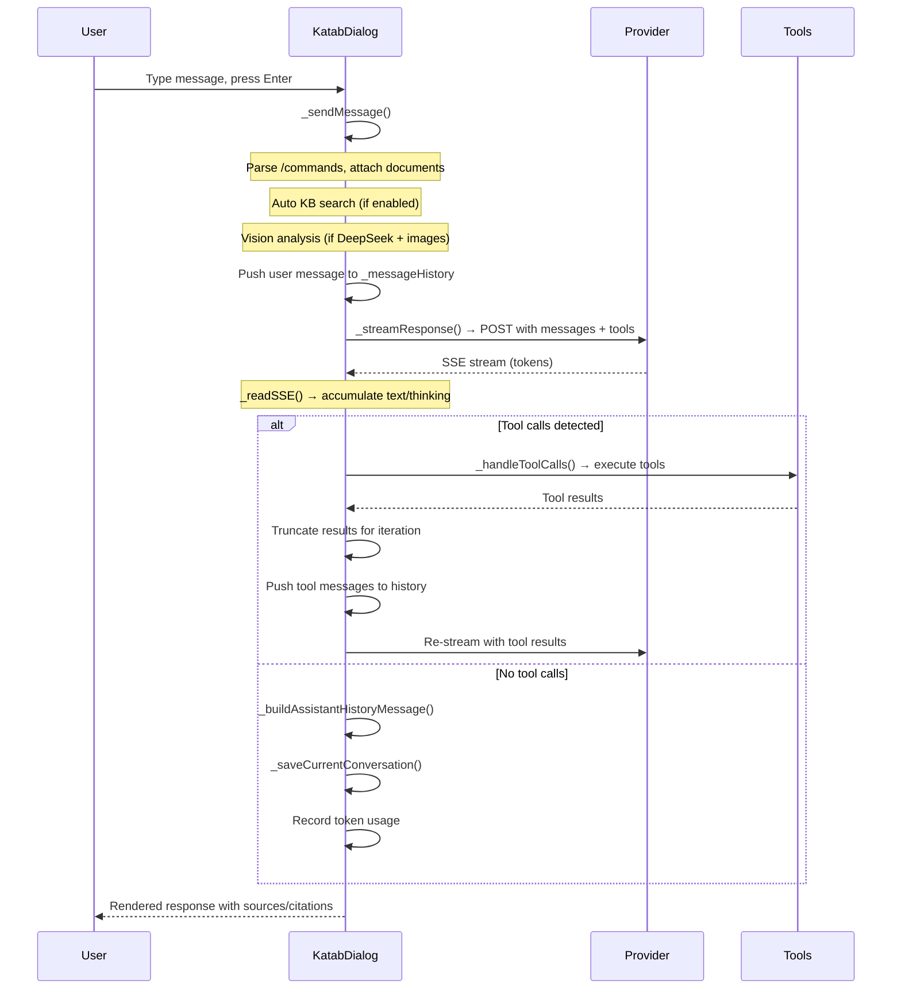

# Katab Development Guide

This document covers setting up a development environment, understanding the project structure, coding conventions, and extending Katab with new features.

---

## Table of Contents

- [Environment Setup](#environment-setup)
- [Project Structure Walkthrough](#project-structure-walkthrough)
- [Coding Conventions](#coding-conventions)
- [Fidelity Audits for Refactors](#fidelity-audits-for-refactors)
- [Adding a New Provider](#adding-a-new-provider)
- [Adding a New Tool](#adding-a-new-tool)
- [Adding a New Pet](#adding-a-new-pet)
- [Debugging Tips](#debugging-tips)
- [Schema Management](#schema-management)
- [Testing](#testing)

---

## Environment Setup

### Prerequisites
- GNOME Shell 46, 47, or 48
- GJS (GNOME JavaScript, comes with GNOME Shell)
- `glib-compile-schemas` (from the `glib2` package)
- Node.js 20+ and npm (ESLint, Prettier, the test runner, and the syntax checks)
- `gettext` (`msgfmt`) only if you compile translations

### Setup Steps

1. **Clone the repository** to your GNOME Shell extensions directory:
   ```bash
   git clone https://github.com/inderdeepk/katabai-cetikaytools.com.git ~/.local/share/gnome-shell/extensions/katabai@cetikaytools.com
   cd ~/.local/share/gnome-shell/extensions/katabai@cetikaytools.com
   ```

2. **Install developer tooling** (Node.js 20+):
   ```bash
   npm ci
   ```

3. **Compile GSettings schemas** (required after any schema XML change):
   ```bash
   make compile-schemas
   # or: glib-compile-schemas schemas/
   ```

4. **Enable the extension**:
   ```bash
   gnome-extensions enable katabai@cetikaytools.com
   ```

5. **Reload GNOME Shell after changes**:
   - **X11**: `Alt+F2`, type `r`, press Enter.
   - **Wayland**: Log out and log back in, or:
     ```bash
     gnome-extensions disable katabai@cetikaytools.com
     gnome-extensions enable katabai@cetikaytools.com
     ```

6. **Monitor logs**:
   ```bash
   journalctl -f -o cat /usr/bin/gnome-shell | grep -i katab
   ```

7. **Inspect GSettings**:
   ```bash
   gsettings list-recursively org.gnome.shell.extensions.katabai
   gsettings get org.gnome.shell.extensions.katabai provider
   ```

### Optional Services for Full Testing
| Service | Default Port | Purpose |
|---|---|---|
| Ollama | 11434 | Local LLM inference |
| Unsloth Studio | 8888 | Optimized local AI with tools |
| SearxNG | 8080 | Metasearch engine |
| Crawl4AI | 11235 | Browser-based web scraping |
| Python RAG Service | 11435 | Vector search knowledge base |

---

## Project Structure Walkthrough

```
katabai@cetikaytools.com/
├── extension.js              # Main entry: KatabExtension, KatabDialog, Indicator,
│                             #   ProviderHealthMonitor, tool dispatch, research orchestration
├── prefs.js                  # GTK4/Adwaita preferences orchestrator (92 lines, separate process)
├── prefs.css                 # Preferences CSS (loaded by prefs.js via Gtk.CssProvider)
├── stylesheet.css            # Shell overlay St CSS (auto-loaded by GNOME)
├── metadata.json             # Extension manifest (UUID, shell versions, schema id)
├── Makefile                  # compile-schemas/check/audit/lint/format/test/pot/langs/package/
│                             #   install/reload/logs/clean + RAG service targets
├── package.json              # Dev tooling (ESLint/Prettier) — not shipped
├── eslint.config.mjs         # Flat ESLint config
├── .prettierrc.json          # 4-space, single quotes, semicolons, 100 columns
├── scripts/
│   ├── check-syntax.mjs      # Every .js/.mjs parses as an ES module (espree)
│   ├── check-css.mjs         # CSS delimiter balance
│   ├── import-smoke.js       # GJS import smoke for every src/ module
│   ├── run-tests.mjs         # Parallel test runner (--filter, --jobs, --timeout, --verbose)
│   ├── i18n-extract.mjs      # AST-based POT extractor (espree)
│   └── audits/               # Fidelity audits for past refactors (+ README)
├── .github/workflows/ci.yml  # CI: lint/format/checks/tests/package + RAG service tests
├── schemas/
│   ├── org.gnome.shell.extensions.katabai.gschema.xml  # 137 settings keys
│   └── gschemas.compiled                              # Compiled binary (gitignored)
├── po/
│   ├── katabai@cetikaytools.com.pot                    # Generated by `make pot`
│   └── POTFILES.in                                     # Files scanned (keep in sync)
├── rag-service/
│   ├── server.py             # Canonical FastAPI + ChromaDB service source
│   ├── requirements.txt
│   ├── tests/test_server.py  # stdlib unittest suite
│   └── README.md             # Deploy/test notes
├── src/
│   ├── core/                 # historyManager, requestLifecycle (send/stop FSM),
│   │                         #   sessionMemory, titleGenerator, toolCallMarkup
│   ├── providers/            # catalog, chatRequest, nonStreamingRequest,
│   │                         #   historyPayload, streamParse
│   ├── tools/                # toolRegistry, toolDefinitions, webSearchTools,
│   │                         #   crawl4aiTools, exploreDocsTools, ragTools, documentTools
│   ├── research/             # prompts, planner, pipeline, branchRunner, synthesisPrompt,
│   │                         #   compressionTools, citationTracker, researchCache
│   ├── usage/                # tokenUsageManager, deepseekPricing, presetManager (26 settings)
│   ├── pets/                 # petCollection (rules), petSpriteActor (Clutter renderer)
│   ├── shared/               # contentKind, httpBody, i18n, networkGuard, pageLinks, toolModes
│   └── ui/                   # headerBar, welcomePanel, pendingIndicator(+Controller), assistantRender,
│                             #   markdownRender, messageBubble, historyView, sessionInfoPopup,
│                             #   toolsPopup, recentChatsPopup, pickers, usagePanel, prefs/*
├── tests/                    # GJS unit-test suites (37 files, run via scripts/run-tests.mjs)
├── icons/                    # Provider logos + Katab SVG icons
├── sprites/                  # Per-provider sprite sets + eggs + pending mixie
└── Documentation/            # Index, Help, Technical, Archive, Research-Reports
```

### Key Dependencies

```mermaid
graph TD
    extension.js --> toolDefinitions.js
    extension.js --> toolRegistry.js
    extension.js --> webSearchTools.js
    extension.js --> crawl4aiTools.js
    extension.js --> exploreDocsTools.js
    extension.js --> ragTools.js
    extension.js --> documentTools.js
    extension.js --> src/research/*
    extension.js --> tokenUsageManager.js
    extension.js --> presetManager.js
    extension.js --> petCollection.js
    extension.js --> petSpriteActor.js
    extension.js --> networkGuard.js
    toolDefinitions.js --> toolRegistry.js
    toolDefinitions.js --> ragTools.js
    toolDefinitions.js --> exploreDocsTools.js
    webSearchTools.js --> networkGuard.js
    webSearchTools.js --> pageLinks.js
    crawl4aiTools.js --> networkGuard.js
    crawl4aiTools.js --> contentKind.js
    exploreDocsTools.js --> pageLinks.js
    branchRunner.js --> pageLinks.js
    tokenUsageManager.js --> petCollection.js
    usagePanel.js --> petSpriteActor.js
    prefs.js --> src/ui/prefs/*  (generalPage → tokenUsageManager, petCollection;
                                 ollamaPage → presetManager;
                                 tools/* → webSearchTools, crawl4aiTools, ragTools)
```

### Data Flow (Message Send)



---

## Coding Conventions

### JavaScript (GJS)
- **ES Modules**: Use `import`/`export`. No CommonJS.
- **GObject Classes**: Extend `GObject.Object`, register with `GObject.registerClass()`.
- **Soup v3**: Import with `gi://Soup?version=3.0`. Always include version.
- **Async**: `async`/`await` with `Gio.Cancellable`. Never block the main thread.
- **Error handling**: Wrap `JSON.parse`, API calls, and file I/O in try/catch.
- **Naming**: camelCase for variables/methods, PascalCase for classes, UPPER_SNAKE_CASE for constants.
- **Comments**: JSDoc-style for public APIs. Explain _why_, not _what_.
- **No API keys in source**: All secrets go through GSettings. Never commit keys.

### GSettings Schema
- **Always recompile** after XML edits: `glib-compile-schemas schemas/`
- Key naming: lowercase with hyphens (`deepseek-vision-model`).
- Keybinding keys: type `as` (string array), not `s`.
- Default values must be valid for the key type.

### GNOME Shell St CSS (`stylesheet.css`)
- **No `flex-wrap` or `text-transform`** — not supported by St toolkit.
- **Avoid `border-radius` and `box-shadow`** on large containers — triggers `ClutterOffscreenEffect` which can exceed GPU texture limits on long content.
- Use `rgba()` for transparency, not `opacity`.
- Every chat UI class needs both `.katab-theme-dark` and `.katab-theme-light` variants.

### Clutter UI (`extension.js`)
- **Selectable text**: Set `reactive=true`, `selectable=true`, `cursor_visible=true`, `editable=false`, and wire custom `button-press`/`motion`/`button-release` handlers that return `Clutter.EVENT_STOP`. Never set read-only `ClutterText` as editable — it strips Pango markup.
- **Byte vs. character offsets**: `clutter_text_coords_to_position()` returns UTF-8 byte indices. `set_selection()` expects character offsets. Convert with a `g_utf8_strlen(text, maxbytes)` helper.
- **Key focus**: `widget.grab_key_focus()`, never `global.stage.set_key_focus()`.
- **Clipboard**: `St.Clipboard.get_default().set_text(St.ClipboardType.CLIPBOARD, text)`.

### Asynchronous Pattern
```javascript
async _someAsyncMethod() {
    const cancellable = new Gio.Cancellable();
    try {
        const result = await new Promise((resolve, reject) => {
            this._soupSession.send_and_read_async(
                message,
                Gio.Priority.DEFAULT,
                cancellable,
                (session, result) => {
                    try {
                        const bytes = session.send_and_read_finish(result);
                        resolve(bytes);
                    } catch (e) {
                        reject(e);
                    }
                }
            );
        });
        return result;
    } catch (e) {
        if (!cancellable.is_cancelled()) {
            throw e;
        }
    }
}
```

---

## Fidelity Audits for Refactors

The `scripts/audits/` directory holds **fidelity audits**: scripts that prove a
past refactor was a pure code move by re-extracting the pre-refactor method
bodies from git history and flat-comparing them against the current sources
(transformed by the documented renames). One audit exists for each extraction
in the maintainability program — see `scripts/audits/README.md` for the table
and the full technique.

```sh
make audit                              # all audits, from the repo root
node scripts/audits/audit-pickers.mjs   # a single audit
```

Guidelines when you refactor code that has an audit coverage:

- **Run `make audit` after the change.** A `DIFF` points at the exact
  character where the moved text diverged — investigate before shipping.
- **Intentional drift** (renamed helpers in comments, newly added
  `accessible_name` / `_()` wrappers) is allowed with *exact-match* entries in
  the audit's allowance list — never with broad wildcard regexes.
- **New refactors get a new audit**: note `HEAD` before the move, then write
  `scripts/audits/audit-<name>.mjs` against that ref (the README has the
  template and the known pitfalls). In-place reorganizations use the
  line-coverage variant (multiset of lines + contiguous-slice checks).
- Audits **skip** (exit 0 with a notice) on shallow clones, so they are a
  local gate — run them before commit; CI keeps running `make check`/`test`.

---

## Adding a New Provider

A new backend touches six places. The rule is: identity in `catalog.js`, payload shaping in
`providers/`, UI in `ui/prefs/`, and nothing provider-specific inside `extension.js` beyond the
config snapshot and probe wiring.

### Step 1: Add GSettings keys
In `schemas/org.gnome.shell.extensions.katabai.gschema.xml`:
```xml
<key name="newprovider-url" type="s">
  <default>'https://api.newprovider.com'</default>
  <summary>NewProvider Base URL</summary>
</key>
<key name="newprovider-api-key" type="s">
  <default>''</default>
  <summary>NewProvider API Key</summary>
</key>
<key name="newprovider-model" type="s">
  <default>'default-model'</default>
  <summary>NewProvider Model</summary>
</key>
```
Recompile with `make compile-schemas` and add the keys to the settings tables in
[API_REFERENCE.md](API_REFERENCE.md).

### Step 2: Register identity in `src/providers/catalog.js`
Add an entry to `PROVIDER_META` (`label`, `iconFile`) and, for the preferences copy, to
`PROVIDER_DETAILS` (`pageTitle`, lazy `description`). `PROVIDER_LABELS`,
`PROVIDER_ICON_STYLE_CLASSES`, and `PROVIDER_ACCENT_CLASSES` derive from `PROVIDER_META`
automatically. Add the icon to `icons/`.

The active-provider list is validated in `extension.js`; search for the existing provider keys
(e.g. `'deepseek'`) and extend the provider switch, the settings snapshot, and the header picker.

### Step 3: Add the streaming request builder
In `src/providers/chatRequest.js`:
- If the provider is OpenAI-compatible, add a thin wrapper around
  `buildOpenAiCompatStreamRequest()` (endpoint, headers, payload with `stream: true`, tool schemas,
  `stream_options: { include_usage: true }`).
- Otherwise follow `buildDeepSeekStreamRequest()` / `buildAnthropicStreamRequest()` for shape.
- Keep API keys out of logs and return `{ endpoint, headers, payload }`.

### Step 4: Add the non-streaming builder
`src/providers/nonStreamingRequest.js` powers planning, gap analysis, compression, title generation,
and vision pre-processing. Add `buildNonStreamingChatRequest()` support plus
`extractNonStreamingText()` / `extractNonStreamingUsage()` branches for the response shape.

### Step 5: Add the stream parser
In `src/providers/streamParse.js`, parse the provider's lines into the shared accumulator
(text, thinking, tool calls, usage). Reuse `parseOpenAiCompatChunk()` when the format matches.

### Step 6: Add the health probe
In `extension.js::ProviderHealthMonitor._buildProbe()`, return `{ method, url, headers, body }` for
the provider's cheap health endpoint. A provider with a missing URL/key is reported as
`needs-setup` before any probe runs.

### Step 7: Add the preferences page
Add the page in `src/ui/prefs/providerPages.js` (URL, API key, model, context size) using
`createProviderPage()` and the shared row factories from `widgets.js`. Use a dedicated module under
`src/ui/prefs/` only when the provider needs real custom UI (as DeepSeek and Ollama do).

### Step 8: Optional integrations
- **Pricing** — add model rates to `MODEL_PRICING` in `src/usage/tokenUsageManager.js` so cost and
  budget estimates are meaningful.
- **Pet** — add a `PET_DEFINITIONS` entry and sprites if the provider should get a companion
  (see [Adding a New Pet](#adding-a-new-pet)).
- **i18n** — if you add a new source file with UI strings, add it to `po/POTFILES.in`.

### Step 9: Test
```bash
# Hit the provider's API directly first
curl -X POST https://api.newprovider.com/chat/completions \
  -H "Content-Type: application/json" \
  -H "Authorization: Bearer YOUR_KEY" \
  -d '{"model":"default-model","messages":[{"role":"user","content":"hello"}],"stream":true}'

make compile-schemas && make check
make reload && make logs
```
Then exercise: send, stop mid-stream, tool call, history reload, and preferences edit.

---

## Adding a New Tool

### Step 1: Define the Tool
In `src/tools/toolDefinitions.js`, register the tool:
```javascript
registerTool({
    name: 'my_tool',
    description: 'What this tool does for the model.',
    parameters: {
        type: 'object',
        properties: {
            query: {
                type: 'string',
                description: 'The input to process.',
            },
        },
        required: ['query'],
    },
    dangerLevel: DANGER_READ_ONLY, // or DANGER_POTENTIALLY_UNSAFE
    handler: createNotReadyHandler('my_tool'),
    uiLabel: 'My Tool',
    uiIcon: 'icon-name-symbolic',
    command: '/mytool',            // null if no slash command
    resultTruncationKey: 'myTool', // null if not applicable
    isMeta: false,                 // true if meta-mode like deep_research
    providerScoped: false,         // true if only for specific providers
});
```

### Step 2: Create a runtime module (network/processing)
Create `src/tools/myTool.js` with a config reader (`readMyToolConfig(settings)`), a runtime class
with async methods, an error class (`MyToolError extends Error` with a `code`), and a result
formatter (`buildMyToolResultBlock(result)`). Keep it free of Clutter/St imports so it can be
unit-tested.

### Step 3: Wire the handler
Add the tool name to the `expected` list in `extension.js::_initToolRegistry()` (a startup
consistency check), then handle it in `_executeToolCall()` — the dispatcher is a chain of
`toolName === ...` checks, not a `switch`:

```javascript
if (toolName === 'my_tool') {
    const result = await this._myToolRuntime.process(args.query);
    return { tc, toolName, resultText: buildMyToolResultBlock(result) };
}
```

Also check the mode gate (`_isMyToolEnabled`) and the danger partition if the tool should be
available under a footer mode.

### Step 4: Add GSettings keys (if configurable)
Add keys to `schemas/org.gnome.shell.extensions.katabai.gschema.xml` and recompile.

### Step 5: Add a preferences subpage
Add a section module under `src/ui/prefs/tools/` (export `build…Section(ctx)` returning the subpage) and register it in `src/ui/prefs/tools/index.js` — the shared row/subpage builders come from `src/ui/prefs/widgets.js`.

### Step 6: Add a footer button (if user-triggerable)
In `extension.js`, add a footer button and wire it to initialize the tool.

### Step 7: Safety considerations
- **Network tools**: Always use SSRF protection (`src/shared/networkGuard.js`).
- **Danger level**: Mark `potentially_unsafe` if the tool could execute code or modify files.
- **Content safety**: If the tool returns untrusted data, ensure the web content safety policy is active.

---

## Adding a New Pet

Pet definitions live in `src/pets/petCollection.js`.

### Step 1: Add Provider to Pet System
```javascript
export const PET_PROVIDERS = Object.freeze([
    'ollama', 'unsloth', 'openai', 'anthropic', 'deepseek',
    'newprovider', // added
]);

export const PET_DEFINITIONS = Object.freeze({
    // ... existing pets
    newprovider: Object.freeze({
        provider: 'newprovider',
        name: 'PetName',
        directory: 'petname',
        iconFile: 'newprovider-icon.svg',
    }),
});
```

### Step 2: Add Sprite Assets
Create `sprites/<directory>/` with the exact pose files the renderer looks for:

```
sprites/<slug>/<slug>_baby_idle_01.png     sprites/<slug>/<slug>_adult_idle_01.png
sprites/<slug>/<slug>_baby_idle_02.png     sprites/<slug>/<slug>_adult_idle_02.png
sprites/<slug>/<slug>_baby_sleep.png       sprites/<slug>/<slug>_adult_sleep.png
sprites/<slug>/<slug>_baby_tip.png         sprites/<slug>/<slug>_adult_tip.png
                                           sprites/<slug>/<slug>_adult_celebrate.png
sprites/eggs/egg_<slug>.png
```

`getPetSpriteCandidates()` builds the paths from `<slug>`, the stage's `spriteFamily`
(`egg`/`baby`/`adult`), and the pose; missing files fall back to the idle frame and then the egg.
Keep the reference list in `Documentation/Archive/PET_SPRITE_CHECKLIST.md` updated.

### Step 3: Pricing (optional)
Add model rates to `MODEL_PRICING` in `src/usage/tokenUsageManager.js` if the provider is billed.

### Step 4: Test
```bash
gjs -m tests/petCollection.test.js   # pet rules only
make test                            # every suite
```

---

## Debugging Tips

### Journal Monitoring
```bash
# Tail Katab-specific logs
journalctl -f -o cat /usr/bin/gnome-shell | grep -i katab

# Look for errors (case-insensitive)
journalctl -f -o cat /usr/bin/gnome-shell | grep -iE 'katab|error|warn'

# Check extension status
journalctl -b -o cat /usr/bin/gnome-shell | grep -i 'katab\|extension'
```

### Looking Glass (GNOME Shell Inspector)
1. Press `Alt+F2`, type `lg`, press Enter.
2. Go to the **Extensions** tab to see Katab's status.
3. Go to the **Errors** tab to see runtime errors with stack traces.
4. Use the **Windows** tab to inspect the dialog's actor tree.

### GSettings Inspection
```bash
# List all Katab settings
gsettings list-recursively org.gnome.shell.extensions.katabai

# Get a specific value
gsettings get org.gnome.shell.extensions.katabai provider

# Set a value directly
gsettings set org.gnome.shell.extensions.katabai ollama-model llama3.2
```

### Common Pitfalls

#### Offscreen Framebuffer Errors
`"Failed to create offscreen effect framebuffer"` means `border-radius` or `box-shadow` on a large container triggers `ClutterOffscreenEffect` which creates textures exceeding `GL_MAX_TEXTURE_SIZE`. Remove these properties from the offending element.

#### Disposed Widget Access
`"Object ... has been already disposed — impossible to access it"` means code is touching a widget after it was destroyed. Use `_responseUiAlive()` guards before accessing UI elements from async callbacks.

#### Text Selection Drift
Selection appears shifted right on text with multi-byte characters (curly quotes, emoji, CJK). This is a byte vs. character offset mismatch — ensure `_positionFromTextEvent()` converts byte indices to character offsets.

#### Stale History Saves
If assistant responses don't appear in reloaded conversations, check that `HistoryManager.flushSync()` is called after every `_saveCurrentConversation()` and that cache mutations use in-place methods (`splice`, not `filter`).

#### Prompt Doesn't Send
If pressing Enter appears to do nothing, check the request lifecycle state — `[Katab:lifecycle]` journal lines show the current state (a send is dropped while the state is not settled, e.g. during KB/web enrichment). Also check whether RAG auto-search is being skipped or hitting its 8-second cap (`[Katab:rag]` lines).

---

## Schema Management

The GSettings schema (`schemas/org.gnome.shell.extensions.katabai.gschema.xml`) is the single source of truth for all user-configurable settings.

### Rules
1. **Always recompile** after any XML change: `glib-compile-schemas schemas/`
2. **Key naming**: `lowercase-with-hyphens`, prefixed with provider name for provider-specific keys (`ollama-model`, `deepseek-api-key`).
3. **Keybinding type**: Always `as` (string array), never `s`.
4. **Defaults**: Must be valid for the type. Booleans default to `false` unless the feature should be on by default.
5. **Summaries**: Short description (shown in dconf-editor). Descriptions: longer explanation.
6. **Never commit `gschemas.compiled`** — it's in `.gitignore`.

### Adding a Key
```xml
<key name="my-feature-enabled" type="b">
  <default>false</default>
  <summary>Enable My Feature</summary>
  <description>Longer description of what this feature does.</description>
</key>
```

### Reading in Code
```javascript
// In extension.js or a src/ui/prefs/ page module (prefs.js is just the orchestrator)
const enabled = this._settings.get_boolean('my-feature-enabled');

// Watch for changes
this._settings.connect('changed::my-feature-enabled', () => {
    // React to change
});
```

---

## Testing

### Unit Tests
```bash
# Run all suites (parallel, compact summary)
make test

# Per-suite counts and timings
make test-verbose

# Run one suite, or a filtered subset
gjs -m tests/petCollection.test.js
node scripts/run-tests.mjs --filter petCollection

# RAG service (stdlib unittest, service venv)
make test-rag-server
```

### Syntax and fidelity checks
```bash
make check            # ES-module parse (all JS incl. scripts/), CSS delimiter balance, gjs import smoke
make audit            # re-extract pre-refactor bodies from git history and compare
npm run lint          # ESLint (flat config)
npm run format:check  # Prettier verification
npm run format        # rewrite files to canonical style (fixes format:check)
```

If `format:check` flags files you did not edit, an editor formatter is fighting the repo style — set your default JS formatter to the workspace Prettier extension (see `.vscode/settings.json`).

### In-Shell Validation
The authoritative test is a live GNOME Shell reload:
```bash
gnome-extensions disable katabai@cetikaytools.com
gnome-extensions enable katabai@cetikaytools.com
journalctl -f -o cat /usr/bin/gnome-shell | grep -i katab
```

### Test Patterns
Each suite exports an array of `[name, fn]` entries and awaits the shared
harness, which handles sync and async tests and fails the process on any error:
```javascript
import { myFunction } from '../src/some/module.js';
import { assertEqual, runTests } from './testUtils.js';

const tests = [
    [
        'myFunction: returns the expected value',
        () => {
            assertEqual(myFunction('input'), 'expected');
        },
    ],
];

await runTests(tests);
```

Shared helpers in `tests/testUtils.js`: `assert`, `assertEqual`, `assertDeepEqual`,
`assertThrows`, `createMockSettings`, `createMockLlmCall`, `makeTempDir`,
`removeTempDir`, `readTextFile`.

### What Can Be Tested
- **Pure logic modules** (no Clutter/St/Gtk imports): `src/core/*`, `src/providers/*`, `src/research/*`,
  `src/shared/*`, `src/usage/*`, `src/pets/petCollection.js`, `src/ui/markdownRender.js`, and the pure
  helpers in `src/tools/*`.
- **Cannot be unit tested in GJS-only runs**: Clutter/St/Gtk widgets, live network calls, and real
  provider responses. These are covered by `make check` (parse + import smoke) and in-shell testing.

### Testing New Features
1. Run `make check` for syntax validation.
2. Run `make test` for unit tests.
3. Reload the extension and check `journalctl` for errors.
4. Manually test the feature end-to-end with a live provider.
5. Test light and dark theme variants.
6. Test error paths (disconnect network, wrong URL, invalid API key).
